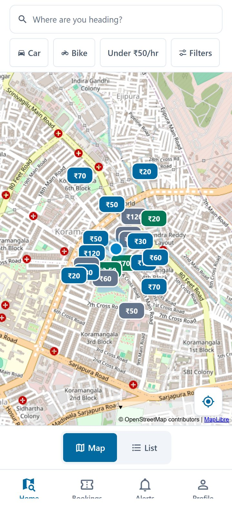
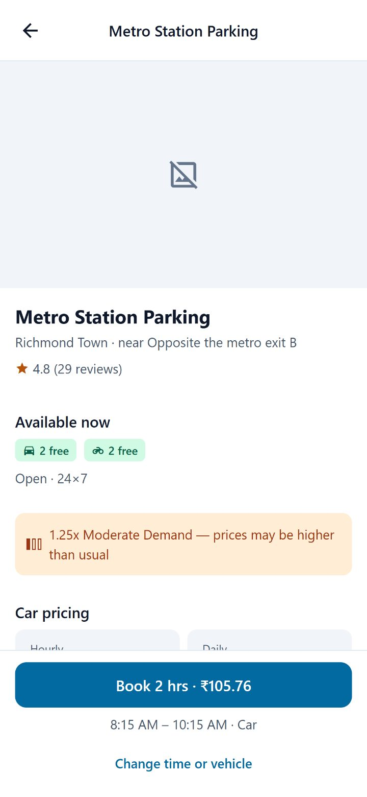
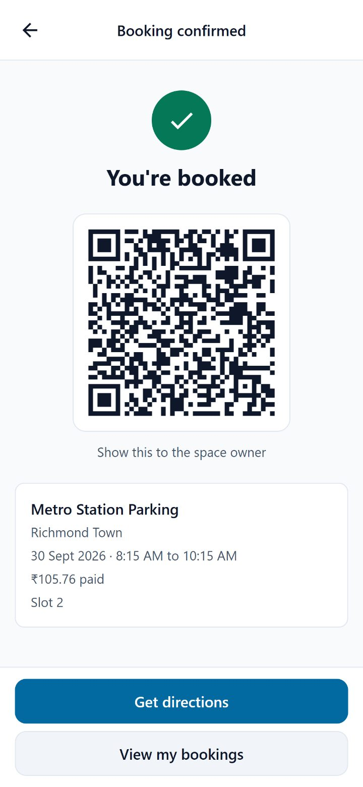
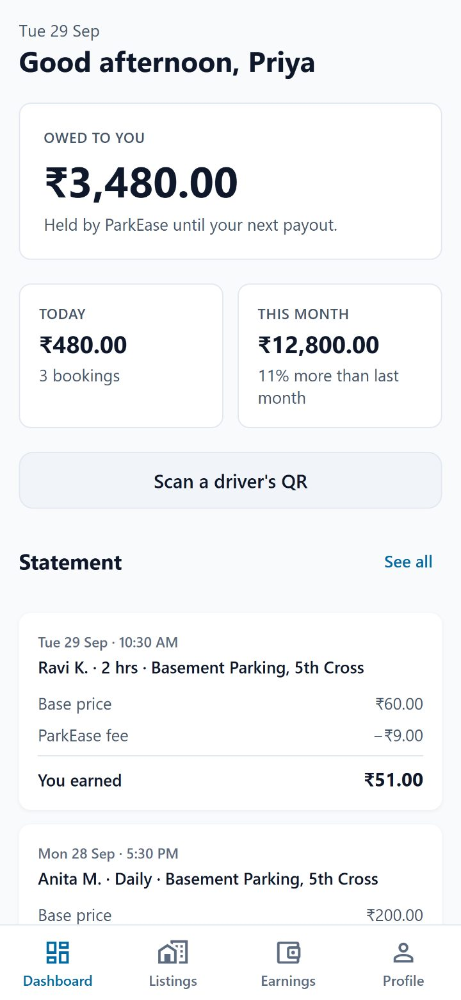
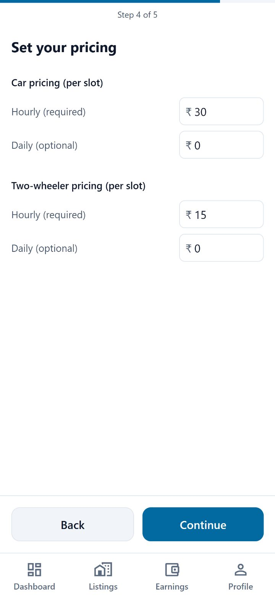
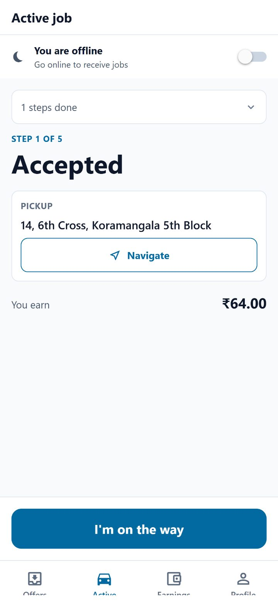
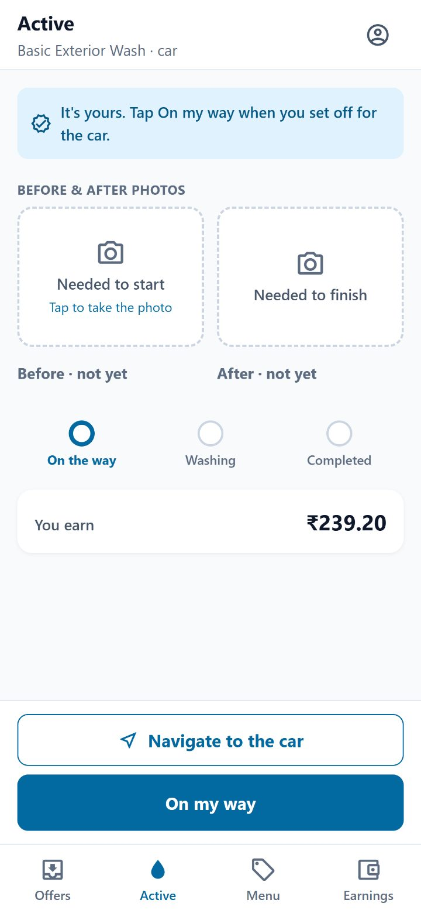
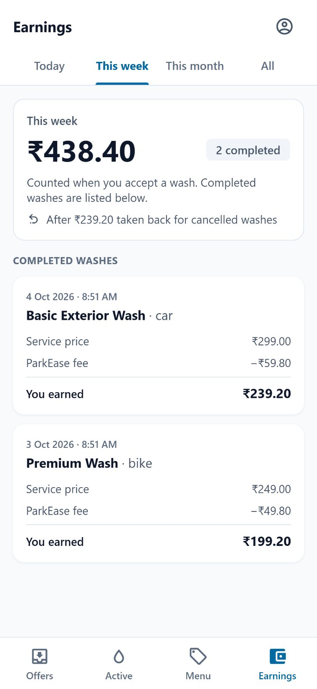
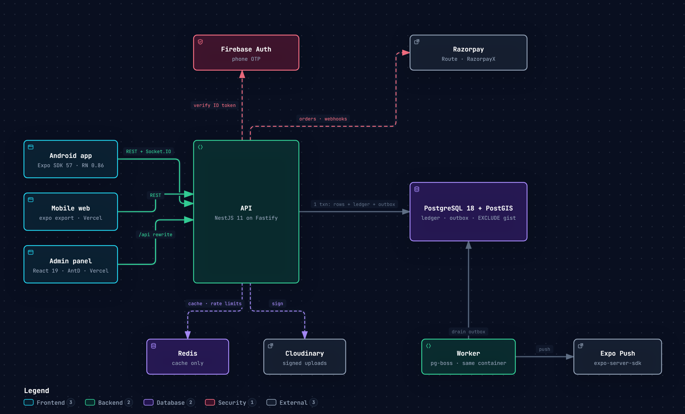

# ParkEase

Peer-to-peer parking marketplace for India. Drivers find and book a free slot before they leave
home; owners earn from empty driveways and basements; valets and car washers pick up jobs on top.
Five roles (driver, owner, valet, washer, admin), one Android app, an API, a job worker, an admin
panel and a marketing site — built solo, at zero recurring cost.

**Live:** [parkease-web-navy.vercel.app](https://parkease-web-navy.vercel.app) (marketing site) ·
**Build log:** [dev.to/rakno](https://dev.to/rakno) · **Videos:** [below](#videos)

<p>
  
  
  
  
</p>
<p>
  
  
  
  
</p>

<sub>Screens from the running app with Bangalore seed data.</sub>

## By the numbers

|              |                                                                                                                  |
| ------------ | ---------------------------------------------------------------------------------------------------------------- |
| Built        | 5 weeks, 29 merged PRs (Sep 10 – Oct 13, 2026)                                                                   |
| Code         | ~86k lines of TypeScript across 5 apps and 6 packages                                                            |
| API          | 130 HTTP routes in 38 role-scoped controllers, 21 idempotent background jobs                                     |
| Database     | 58 hand-written SQL migrations, PostgreSQL 18 + PostGIS 3.6                                                      |
| Mobile       | 52 screens, Android-only, New Architecture                                                                       |
| Tests        | 3,246 unit tests across 8 packages, plus 55 integration suites on real Postgres (Testcontainers), Playwright E2E |
| Decisions    | 34 architecture decision records                                                                                 |
| Running cost | ₹0/month — every service on a free tier; the only spend is Google Play's $25 one-time fee                        |

**Measured, and asserted in CI so they cannot regress:**

- **Search: p95 < 200 ms, p99 < 400 ms** over 200 requests against 10,000 spaces, with the test
  failing if the plan ever falls back to a `Seq Scan` on `spaces`.
- **100 drivers racing for 10 slots → exactly 10 bookings**, every other request a clean `409`,
  zero 5xx, p95 under 2 s. Before an advisory-lock fix the same race produced chained deadlocks
  and a **56 s p95**.
- **Admin dashboard: 200 concurrent loads over 250k ledger rows at p95 213 ms**, down from
  **9.8 s**, by coalescing identical in-flight queries instead of adding a cache that could
  disagree with the balances screen.
- **No double booking, ever** — enforced by an `EXCLUDE USING gist` constraint, not app code.
  A test drops the constraint and watches the double-sell come back.
- **The ledger balances** — `SUM(debits) = SUM(credits)` for every transaction, checked by a
  dedicated suite and re-checked by a worker job every 15 minutes that flags any imbalance.

## Architecture



- **API** — NestJS 11 on Fastify. `roles/` (controllers only) → `domains/` (business logic as
  command classes) → `platform/` (auth, RBAC, idempotency, outbox). The layering is an ESLint rule,
  so a controller importing another role's code fails the build.
- **Worker** — pg-boss jobs fed by a **transactional outbox**: business rows, ledger entries and the
  outbox message commit together, so an event is never lost and never sent for a rolled-back write.
  Every handler is idempotent because delivery is at-least-once.
- **Money** — integer paise everywhere, a double-entry ledger as the source of truth, and exactly one
  module allowed to produce an amount. The client displays server-issued quotes and never computes
  a price.
- **Payments** — Razorpay Route splits each payment between owner and platform; RazorpayX pays out
  weekly. Webhooks are signature-verified before parsing, and the server re-fetches every order
  rather than trusting what the client says was paid.
- **Contracts** — one Zod schema per payload, shared by the API, mobile app, admin panel and
  OpenAPI. Every boundary validates: requests, webhooks, job payloads, env, uploads (magic bytes).
- **No external call inside a transaction**, idempotency keys on every mutation, single-flight
  token refresh on the client, role guard _and_ ownership check on every resource.

## Stack

| Layer                   | Choice                                                       |
| ----------------------- | ------------------------------------------------------------ |
| Monorepo                | pnpm workspaces + Turborepo                                  |
| API                     | NestJS 11 on the Fastify adapter                             |
| Worker                  | pg-boss, transactional outbox                                |
| Database                | PostgreSQL 18 + PostGIS 3.6, Drizzle ORM                     |
| Contracts               | Zod, shared across API, mobile, admin and OpenAPI            |
| Mobile                  | Expo SDK 57, React Native 0.86, New Architecture, MapLibre   |
| Admin                   | React 19 + Vite + Ant Design 5 + TanStack Router             |
| Web                     | Next.js 15, App Router, Tailwind 4                           |
| Auth / payments / media | Firebase phone OTP · Razorpay Route + RazorpayX · Cloudinary |
| Observability           | OpenTelemetry, Pino with trace ids                           |
| Runtime                 | Node.js 24 LTS                                               |

## Videos

Each role got an engineering deep-dive and a 60-second role short.

| Role       | Engineering                                                                    | For users                                                                       |
| ---------- | ------------------------------------------------------------------------------ | ------------------------------------------------------------------------------- |
| Owner      | [One booking. Three answers. Only one was true.](https://youtu.be/4eCw2jclaYM) | [Your empty parking spot just got a job](https://youtu.be/wf_wQYXr0nk)          |
| Driver     | [The map was blank. Every test was green.](https://youtu.be/dFxDWZCSR_A)       | [Stop circling the block](https://youtube.com/shorts/JzmtjPphnu4)               |
| Valet      | [The signal dropped. Mid-trip. With your car.](https://youtu.be/l9PbOy-gCLE)   | [Hand over the keys. Get the car back.](https://youtube.com/shorts/0gKVcDvU_GA) |
| Car washer | [Three washers. One job. Zero locks.](https://youtu.be/Iv9fOmssZlI)            | [The car wash that comes to the car](https://youtube.com/shorts/Yf-iWzAQtmY)    |

Write-ups: [Postgres won't let me double-book a parking slot — exclusion constraints in practice](https://dev.to/rakno/postgres-wont-let-me-double-book-a-parking-slot-exclusion-constraints-in-practice-4aa5)
and the rest of the [Building ParkEase](https://dev.to/rakno) series.

## Development

```bash
pnpm install
docker compose up -d      # PostgreSQL 18 + PostGIS 3.6 + Redis 7
pnpm db:migrate && pnpm db:seed
pnpm dev                  # all five apps
```

```bash
pnpm turbo run lint typecheck test   # unit
pnpm test:integration                # real Postgres via Testcontainers
```

## Deployment

Free tiers only. The API and the worker run as two processes in one Render free container
(`Dockerfile.demo`, `render.yaml`); CI runs migrations and then calls Render's deploy hook
(`.github/workflows/deploy.yml`), so migrations never run at boot. The admin panel, the mobile web
build and this marketing site deploy to Vercel. Android release builds run locally through Gradle.

## Notes

Architecture decisions, coding rules and implementation tasks are maintained outside this
repository.

## License

Proprietary. All rights reserved.
